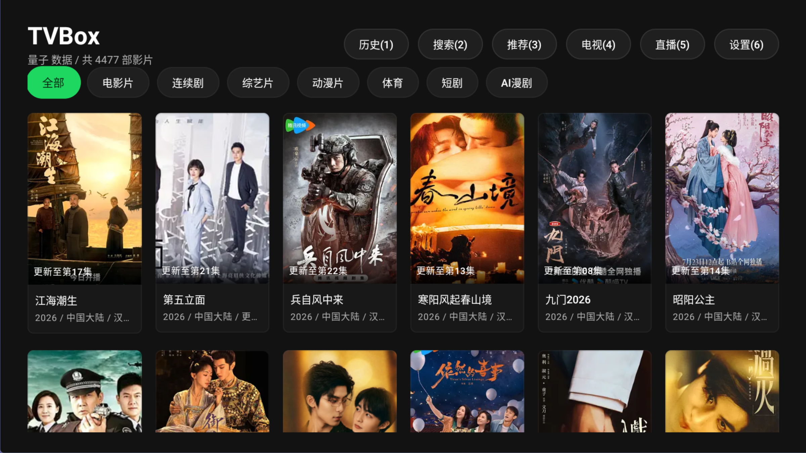

# TVBox

TVBox 是一个面向 Android TV / 电视盒子的影视播放应用，使用 Kotlin、Jetpack Compose 和 Media3 ExoPlayer 构建。应用重点适配遥控器操作，支持影视分类、搜索、详情、m3u8 播放、观看历史、电视直播和 OTA 更新。

当前源码版本为 `1.4.2`（`versionCode=10402`）。本版本新增首页视频接口测速和一次性选源提示，并修复原接口失效或备用线路晚到时的续播失败。服务端部署方式见 [多平台直播服务部署说明](platform_live_server/DEPLOYMENT.md)。

> 请确保使用的影视与直播接口具备合法授权。本项目仅提供客户端能力，不内置或托管影视内容。

## 界面预览



## 功能特性

- Android TV 适配：支持 `LEANBACK_LAUNCHER`，可在电视桌面启动，同时保留普通 Android 启动入口。
- 遥控器友好：方向键、确认键、返回键、菜单键和数字键均有对应交互。
- 首页影视列表：默认展示豆瓣热播剧集，支持海报、评分、分页加载、焦点高亮；点击热播卡片后才按片名从当前影视数据源查找详情与播放资源。首选源不可用或返回空列表时，首页按顺序尝试其他数据源。
- 主题切换：设置页支持“默认主题”和“影院主题”；默认主题保留原有顶部快捷入口，影院主题提供左侧图标导航和 Hero 推荐布局。
- 视频接口管理：内置《影视线路地址整理.md》收录的 32 个资源站，并保留原有扩展线路；设置页可选择首页数据源，也可手机扫码添加 MacCms 自定义接口。新安装和旧版升级后首次打开时可测速选源，平时也可在设置中重新测速。
- 搜索与详情：关键词搜索最多三条来源并行，结果增量去重显示；重新进入搜索页时光标位于旧关键词末尾，可用遥控器退格删除。详情页优先显示主来源，后台补齐播放源和选集。
- AI 找片：支持文字、应用内语音识别、快捷推荐词和“换一批”，可在设置页用手机扫码配置大模型、模型名和 API Key。
- 播放器：基于 Media3 ExoPlayer，仅使用其视频解码与画面窗口；TVBox 自行处理遥控器快退/快进、切集、倍速、播放暂停、自动跳下一集和手机播放手势。
- 底栏操作：显示“上一集(1)”“下一集(3)”；点击当前倍速或按播放页菜单键，均直接循环 `1x → 1.25x → 1.5x → 2.0x → 0.75x → 1x`，不弹出倍速面板。
- 画面比例：点播操作栏“画面”支持自适应、裁剪铺满和拉伸铺满，本机记忆并实时生效；播放页隐藏系统栏，退出后恢复。
- 跳过片头：设置页可设默认秒数，播放页“片头”通过预设和 ±5 秒调整本片／整部剧的秒数；没有自定义输入框或“跟随全局”按钮，未单独设置的影片仍使用默认值。仅从头播放和切集时生效，不覆盖历史续播或换线进度。
- 手机扫码输入：搜索页点击“手机扫码输入 · 菜单键”或短按遥控器菜单键打开二维码，手机在可互通的同一局域网扫码输入片名并提交，电视直接搜索；一次性会话 5 分钟有效，退出搜索页或切后台即失效，无需配套手机应用。
  - 该功能的需求建议来自 **LINUX DO 社区用户 patrickpa**，感谢提出让电视遥控器输入更方便的想法。
- 播放设置：底栏保留播放／暂停、上一集、下一集、倍速和设置；右侧面板参照“电视(4)”频道的 260dp 宽度、半透明深色背景和扁平焦点列表，画面、片头、选集与线路的名称和当前值分层显示。仍右上贴边、全高，无关闭按钮，使用返回键逐级退出并恢复焦点。
- 设备模式：设置提供“电视模式”和“手机模式”，默认电视模式，本机保存并优先于系统识别；电视短剧保持横屏，手机模式保留点播转屏和普通直播手机布局。
- 观看历史：首页显示最近六部未看完的「继续观看」。优先尝试上次播成功的来源，失败时查找同一部、同一集的备用线路并保留原进度。
- 返回定位：首页、搜索和历史页面恢复滚动位置与影片焦点；“继续观看”卡片可用方向上返回顶部导航。
- 电视直播：支持 TVBox 文本与 M3U 直播源，主源不可用时自动尝试备用源；支持分组、左右切台、上下切换线路、数字选台，以及线路异常时自动换线。
- 平台直播：支持斗鱼、虎牙、哔哩哔哩、抖音和快手，统一提供平台、一级分类、二级分类、直播间和播放器流程，并按平台返回结果优先选择最高画质；直播间可在本机收藏，在直播入口的“收藏”卡片中直接打开。默认主题和影院主题均可在二级分类内按主播名或标题搜索直播间。
- 播放亮屏：所有播放页在前台保持亮屏，暂停时同样生效；退出播放页或切到后台后恢复原设置。
- 播放中断：切到后台或发生音频焦点中断后暂停，返回后由用户手动恢复播放。
- OTA 更新：系统后台下载 APK，缺少系统下载组件时使用应用备用下载；小窗显示进度与授权状态，前台完成且获得授权后打开安装器，也可保存 APK 后通过文件管理器手动安装。
- 内容过滤：过滤伦理、电影解说、演员、新闻资讯等不需要的分类或资源。

## 遥控器快捷键

首页：

| 按键 | 功能 |
| --- | --- |
| 数字 1 | 历史 |
| 数字 2 | 搜索 |
| 数字 3 | AI 推荐 |
| 数字 4 | 电视直播 |
| 数字 5 | 平台直播 |
| 数字 6 | 设置 |
| 方向键 | 移动焦点 |
| 确认键 | 打开当前焦点内容 |
| 下滑到加载更多 | 自动加载下一页 |

搜索页：

| 按键 | 功能 |
| --- | --- |
| 菜单键 | 打开手机扫码输入；长按不重复触发，二维码已打开时不重新生成 |

播放器：

| 按键 | 功能 |
| --- | --- |
| 确认键 | 展开控制栏，或操作当前聚焦控件 |
| 媒体播放暂停键 | 直接播放或暂停 |
| 方向左 / 右 | 控制栏关闭时每次快退 / 快进 10 秒并支持长按；控制栏打开时导航按钮，聚焦进度条时调整进度 |
| 菜单键 | 与底部倍速按钮相同，直接循环 1x → 1.25x → 1.5x → 2.0x → 0.75x → 1x |
| 数字 1 | 上一集 |
| 数字 3 | 下一集 |
| 返回键 | 设置子项 → 播放设置 → 操作栏 → 详情页 |

直播：

| 按键 | 功能 |
| --- | --- |
| 方向左 / 右 | 上一个 / 下一个频道，支持首尾循环 |
| 方向上 / 下 | 切换当前频道的上一条 / 下一条线路 |
| 确认 / 播放暂停 | 显示左侧频道列表 |
| 数字键 | 输入频道号，例如 `1`、`12` |
| 返回键 | 先关闭频道列表，再返回首页 |

## 安装

从发行版页面下载适用于 Android 9 及以上的 APK。

- [GitHub 发行版](https://github.com/ZxxXinI/tvbox/releases/latest)
- [Gitee 发行版](https://gitee.com/zhen-xin/tv-box/releases)

通过 ADB 覆盖安装可保留本机数据。

```powershell
adb install -r TVBox-v1.4.3.apk
```

## OTA 更新机制

v1.4.3 起，应用检查 [Gitee 更新清单](https://gitee.com/zhen-xin/tv-box/raw/main/update.json)，从清单里的 `apkUrl` 下载安装包。仍通过 GitHub 检查更新的旧版本可以通过 [GitHub 更新清单](https://raw.githubusercontent.com/ZxxXinI/tvbox/main/update.json) 升级到本版。

- `versionCode` 大于当前版本时会提示更新。APK 下载完成后校验大小和 SHA-256。
- 关闭更新弹窗后，后台下载会继续。文件校验完成后可打开系统安装界面，安装仍由用户确认。
- 若电视盒子无法调用安装界面，可从更新小窗选择「保存安装包」，再用文件管理器手动安装。遇到下载失败时，也可以从发行版页面下载安装包。
- 手机用户可在「设置 → 设备模式」选择手机模式。默认电视模式保持横屏。

## 本地构建

环境要求：

- JDK 17
- Android SDK
- 使用项目内 Gradle Wrapper

AI 找片配置：

- 首次使用前，在「设置 → 大模型」配置当前服务商的模型和 API Key。打开「AI 推荐」时可点击「去配置」。
- 内置服务商可沿用默认模型，点击「模型」或「API Key」生成二维码，用手机填写。自定义服务商还需填写兼容的 API 地址，并选择或手动填写模型 ID。

视频接口配置：

- 内置视频接口保留在 APK 中，不会被用户配置覆盖。
- 设置页“视频接口”可选择当前首页、搜索和 AI 找片使用的数据源。
- 点击“添加接口”后，电视弹出二维码；手机扫码填写接口名称和 MacCms 地址，确认后自动同步到电视。
- MacCms 地址示例：`https://example.com/api.php/provide/vod`

平台直播服务配置：

- 服务端运行在电脑或服务器上，TVBox 通过 `TVBOX_PLATFORM_LIVE_SERVICE_URL` 访问统一接口。
- 本次 v1.3.3 Debug 构建使用的服务地址为 `http://20.205.10.127:8868`。
- Windows PowerShell 临时构建配置：

```powershell
$env:TVBOX_PLATFORM_LIVE_SERVICE_URL="http://20.205.10.127:8868"
.\gradlew.bat testDebugUnitTest assembleDebug --console=plain
```

- 该变量只在构建时注入 APK，不需要写入服务器代码；服务器 Cookie 只配置在服务器环境变量中。
- 如果服务器地址变化，必须使用新地址重新构建 APK；不要填写 `localhost` 或 `127.0.0.1`。

运行测试：

```powershell
.\gradlew.bat testDebugUnitTest --console=plain
```

构建 debug APK：

```powershell
.\gradlew.bat assembleDebug --console=plain
```

构建 release APK：

```powershell
.\gradlew.bat assembleRelease --console=plain
```

release APK 输出位置：

```text
app\build\outputs\apk\release\app-release.apk
```

## Release 签名

release 签名信息从 `local.properties`、Gradle 属性或环境变量读取，密钥文件不会提交到仓库。

需要配置：

```properties
TVBOX_RELEASE_STORE_FILE=signing/xxx.jks
TVBOX_RELEASE_STORE_PASSWORD=***
TVBOX_RELEASE_KEY_ALIAS=***
TVBOX_RELEASE_KEY_PASSWORD=***
```

签名校验：

```powershell
apksigner verify --print-certs app\build\outputs\apk\release\app-release.apk
```

## 发布新版本流程

1. 更新版本号和 CHANGELOG，构建并校验签名 APK，给源码打上对应版本标签。
2. 在 GitHub 和 Gitee 的对应发行版上传同一份 APK。Gitee 网页上传方式见 [AGENTS.md](AGENTS.md)。
3. 以未登录状态完整下载 Gitee 的 APK，核对文件大小和 SHA-256，用下载链接生成 `update.json`。
4. 将同一份 `update.json` 上传到两个发行版并同步到两个仓库的 `main`，核对两个 OTA 清单都能读取。

## 项目结构

```text
app/src/main/java/com/tvbox/app
├── data        # API、仓库、历史记录、OTA、直播数据
├── domain      # 领域模型与解析规则
├── ui          # Compose 页面、播放器、直播页
└── MainActivity.kt
```

## 技术栈

- Kotlin
- Jetpack Compose
- Compose for TV 基础能力
- Media3 ExoPlayer
- Retrofit / OkHttp
- kotlinx.serialization
- Coil

## 版本记录

详细变更见 [CHANGELOG.md](CHANGELOG.md)。

## 🔗 友情链接 / Friends

- [LINUX DO](https://linux.do/) — 新的理想型社区 / A new ideal community

